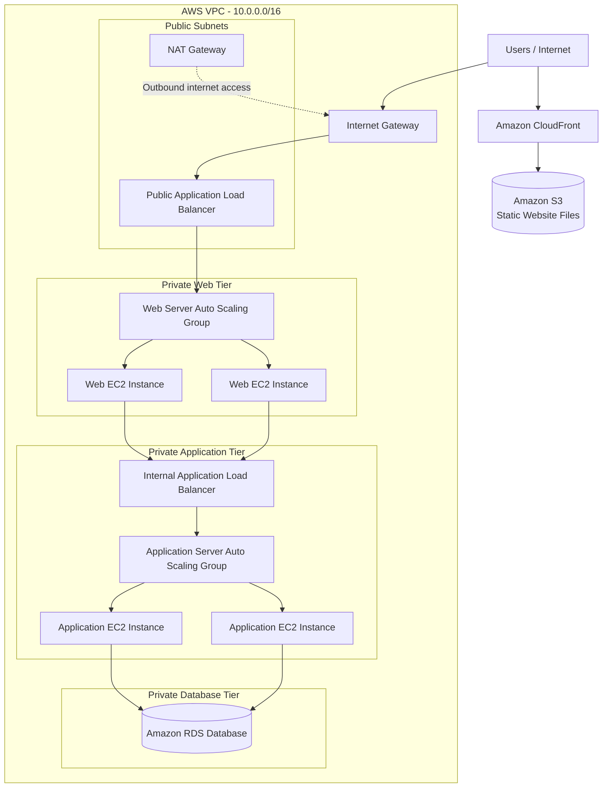

# AWS Three-Tier Architecture

A scalable, secure, and highly available three-tier web application architecture built on Amazon Web Services (AWS).


---

## Table of Contents

- [Overview](#overview)
- [Architecture](#architecture)
- [AWS Services Used](#aws-services-used)
- [Implementation Details](#implementation-details)
- [Project Structure](#project-structure)
- [Project Status](#project-status)
- [Roadmap](#roadmap)
- [Learning Outcomes](#learning-outcomes)
- [Screenshots](#screenshots)
- [Cleanup](#cleanup)
- [Author](#author)

---

## Overview

This project separates a web application into three independent layers, so each can be scaled, secured, and maintained on its own:

| Tier | Purpose | AWS Components |
|------|---------|----------------|
| **Presentation Tier** | Serves the user-facing frontend | S3, CloudFront, Public ALB, Web EC2 (Auto Scaling) |
| **Application Tier** | Runs business logic | Internal ALB, App EC2 (Auto Scaling) |
| **Database Tier** | Stores and manages data | Amazon RDS (private subnets) |

---


## Architecture

### AWS Three-Tier Architecture Diagram



### Request flow

1. Users access static website content through CloudFront, which retrieves content from S3.
2. Application requests reach the Public Application Load Balancer.
3. The Public ALB distributes requests to Web EC2 instances.
4. The Web tier forwards application requests to the Internal ALB.
5. The Internal ALB distributes requests to Application EC2 instances.
6. Application servers communicate with Amazon RDS.
7. NAT Gateway provides outbound internet connectivity for private resources.
```


## AWS Services Used

- **Amazon VPC**: isolated virtual network
- **Public and Private Subnets**: network segmentation across two Availability Zones
- **Internet Gateway**: internet access for public resources
- **NAT Gateway**: outbound internet access for private instances
- **Route Tables**: traffic routing for each subnet tier
- **Security Groups**: stateful, tier-to-tier traffic control
- **Amazon EC2**: web and application servers
- **Application Load Balancer**: one public, one internal
- **Auto Scaling Groups**: elasticity and self-healing for web and app tiers
- **Amazon S3**: static frontend hosting
- **Amazon CloudFront**: global content delivery
- **Amazon RDS**: managed relational database

---

## Implementation Details

### Networking and Security

- Custom VPC with CIDR block `10.0.0.0/16`
- Six subnets across two Availability Zones
- Internet Gateway and NAT Gateway configured
- Route tables created and associated with the correct subnets
- Five Security Groups, one per architecture component, following least-privilege rules

### Storage and Content Delivery

- Amazon S3 bucket created
- Frontend files uploaded: `index.html`, `style.css`, `script.js`
- Amazon CloudFront distribution configured in front of the bucket

### Compute and Database

- EC2 web servers and application servers configured
- Public Application Load Balancer (internet-facing)
- Internal Application Load Balancer (web tier to app tier)
- Auto Scaling Group for the web servers
- Auto Scaling Group for the application servers
- Amazon RDS database configured

---

## Project Structure

Suggested layout for this repository:

```
aws-three-tier-architecture/
├── README.md
├── docs/
│   ├── architecture.png
│   └── screenshots/
├── frontend/
│   ├── index.html
│   ├── style.css
│   └── script.js
├── scripts/
│   ├── web-user-data.sh
│   └── app-user-data.sh
└── terraform/            # planned
    ├── main.tf
    ├── variables.tf
    └── outputs.tf
```

---

## Project Status

**Core AWS infrastructure: completed.**

Domain configuration, HTTPS setup, Terraform, and final testing are still planned.

---

## Roadmap

- [x] VPC, subnets, Internet Gateway, NAT Gateway, route tables
- [x] Security Groups
- [x] S3 bucket and frontend upload
- [x] CloudFront distribution
- [x] Web and application EC2 servers
- [x] Public and internal Application Load Balancers
- [x] Auto Scaling Groups (web and app tiers)
- [x] Amazon RDS database
- [ ] Amazon Route 53 domain configuration
- [ ] AWS Certificate Manager (ACM) for HTTPS
- [ ] Terraform Infrastructure as Code implementation
- [ ] Final end-to-end application testing
- [ ] Final documentation

---

## Learning Outcomes

- AWS VPC and subnet architecture
- Public and private network configuration
- Security Group design and traffic control
- NAT Gateway and Internet Gateway concepts
- EC2 provisioning and Auto Scaling
- Public and internal load balancing
- S3 storage and CloudFront content delivery
- Relational database deployment with Amazon RDS
- Three-tier architecture implementation

---

## Screenshots

Add screenshots to `docs/screenshots/` and link them here:

| Component | Screenshot |
|-----------|------------|
| VPC and Subnets | `docs/screenshots/vpc.png` |
| Security Groups | `docs/screenshots/security-groups.png` |
| Load Balancers | `docs/screenshots/load-balancers.png` |
| Auto Scaling Groups | `docs/screenshots/asg.png` |
| RDS | `docs/screenshots/rds.png` |
| CloudFront | `docs/screenshots/cloudfront.png` |

---

## Cleanup

To avoid unexpected AWS charges, delete resources when finished: Auto Scaling Groups, EC2 instances, load balancers, NAT Gateway (billed hourly), RDS, CloudFront distribution, S3 bucket, and finally the VPC.

---

## Author

**Your Name**
GitHub: [@your-username](https://github.com/your-username)
LinkedIn: [your-linkedin](https://linkedin.com/in/your-linkedin)

---

## License

This project is licensed under the MIT License.
